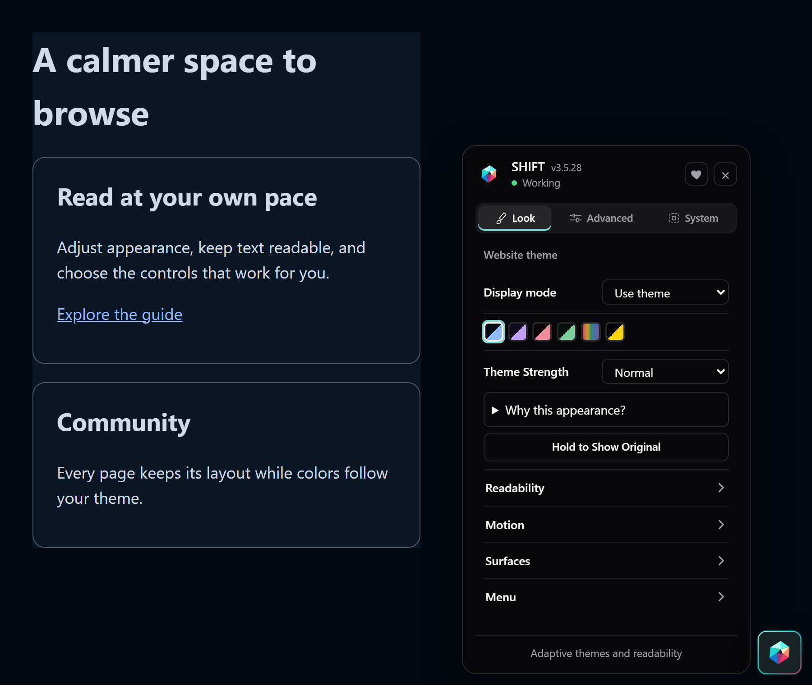
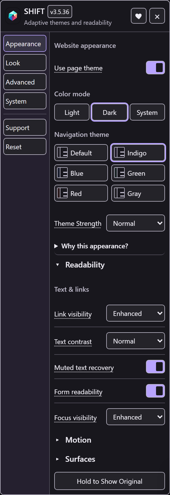

# SHIFT

**A clearer view of the web**

## Get started

1. Install a userscript manager such as [Violentmonkey](https://violentmonkey.github.io/get-it/) or [Tampermonkey](https://www.tampermonkey.net/).
2. [Install SHIFT](https://github.com/ExtraPotions/SHIFT/releases/latest/download/shift.user.js) and confirm in your userscript manager.
3. Refresh any page and open the SHIFT launcher. With other ExtraPotions products installed, they share one launcher: open it and choose SHIFT.

## What you can do

- **Theme any website:** choose Light, Dark, or System with Default, Indigo, Blue, Green, Red, or Gray navigation colors. Turn off Use page theme to show the original site. Retired palettes reset to Default.
- **Read more comfortably:** tune link visibility, text contrast, focus outlines, and visual effects.
- **Set it per site:** use profiles and site-specific choices, and see which setting controls the current page with "Why this appearance?".
- **Recover quickly:** hold to show the original page, pause changes, or keep a specific element untouched.

Known banking, healthcare, and email sites stay unchanged unless you enable SHIFT for that site.

## See it in action

<table>
  <tr>
    <td width="50%" valign="top" align="center"> <strong>Indigo theme on a sample page</strong></td>
    <td width="50%" valign="top" align="center"> <strong>Readability controls</strong></td>
  </tr>
</table>

Screenshots use sample content.

All ExtraPotions menus share the same Core template. Open **System** for status, diagnostics, troubleshooting and Reset. Donations remain in the header heart.

## Support

[Support development](https://ko-fi.com/expdare). Donations are optional. All features remain available without donating.

## License

**Code:** [PolyForm Noncommercial License 1.0.0](LICENSE-CODE.md) 
**Artwork and documentation:** [CC BY-NC-SA 4.0](LICENSE-ASSETS.md)

SHIFT is an independent project and is not affiliated with or endorsed by the websites where it is used.

